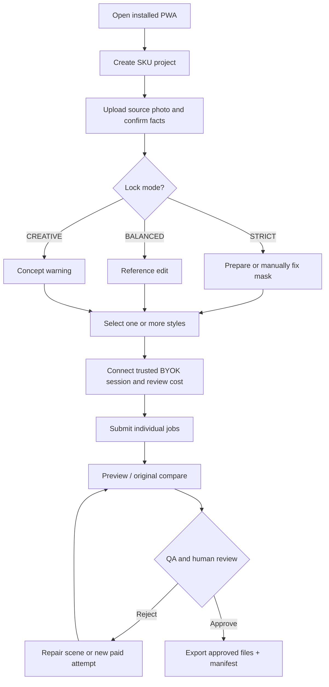

# User Flows and State Expectations

## Flow A — First valid output (MVP golden path)

## Flow B — Input not sufficient

- No source image: only clearly labeled CONCEPT output; no "real SKU / source-faithful" claims.
- Need true overhead/side angle and no compatible reference: block strict shot or offer source-angle "flat-lay-inspired" alternative.
- Text unreadable at source resolution: label as UNVERIFIABLE, request better image/brand artwork.
- User supplies screenshots with store overlays: exclude overlays not physically printed on product.

## Flow C — Security/cost failure

- Session expired: do not expose Key; ask to reconnect; preserve local job drafts.
- Pre-submit estimate above user soft budget: require explicit one-time override or cancel.
- HTTP 429: show `retry-after` when present, queue or defer, do not automatically multiply requests.
- Post-submit timeout/connection loss: mark Attempt `UNKNOWN`; no automatic resubmission; user must acknowledge potential cost before manually retrying.

## Flow D — Offline and update

- Offline: shell loads and local source/output files render; editor and export work if data exists. `Generate` disabled with network reason.
- Worker new version: active user sees visible update CTA; no reload until explicit consent; save/flush work before controlled update; handle update failure with recovery.

## Flow E — Import backup

- Inspect ZIP manifest and hashes, reject traversal and oversized or corrupt entries, preview import diff, preserve existing data until commit, support version-migration or explicit failure message.

## Success / failure UX rules

- Never display "Done" until file has persisted and QA/approval state is explicit.
- Show which actions are local versus chargeable; one style Retry is one distinct attempt.
- Image output cannot be marketed as real photographed product if concept-level changes are visible without disclosure.
