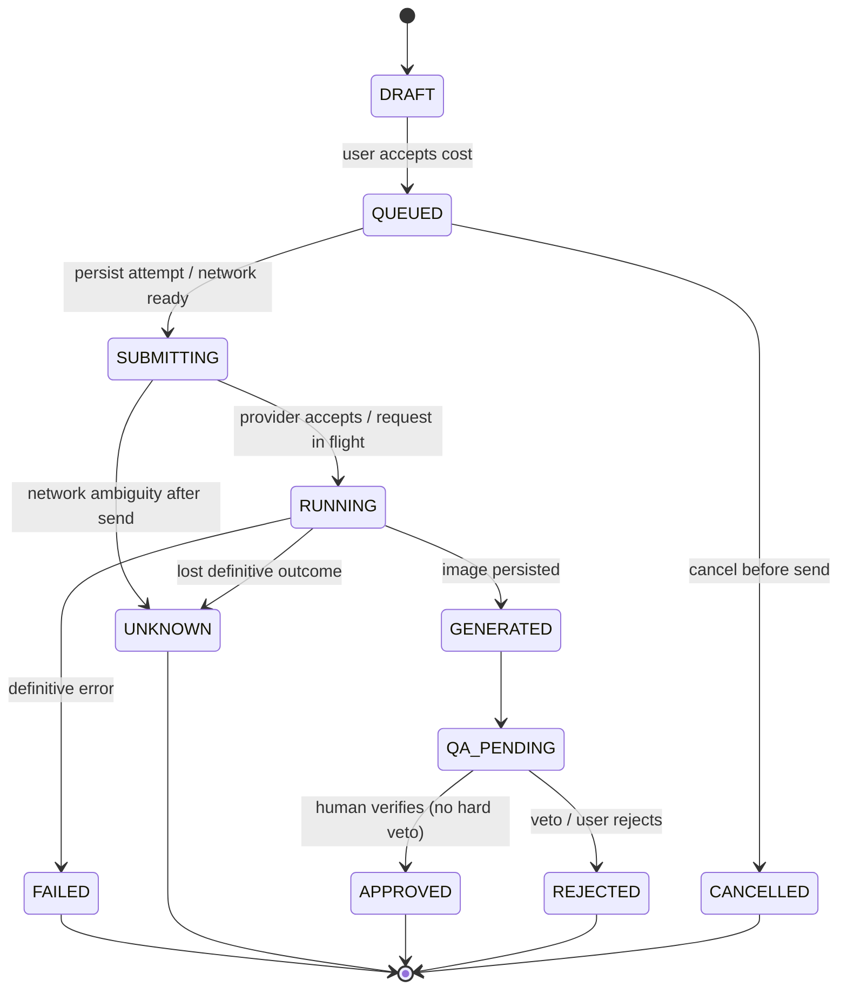

# Generation Jobs, Attempts, State Machine and Idempotency

## Entity semantics

- One `GenerationJob` = product + one style + selected settings + source/lock/prompt snapshot. Users can create 1–7 independent jobs.
- Each provider submission is an immutable **Attempt** with its own ID, timestamps, request hash, provider request ID where available, estimated/observed cost and outcome.
- A style (notably billboard) may need multiple planned generation/edit stages. Display **anticipated provider call count** before paying. "7 styles" does **not** guarantee exactly 7 billable API calls.
- Rerun creates a new Attempt; old output/QA remain intact. No overwrite or hidden reuse of rejected image.

## State transitions

No automatic `UNKNOWN→SUBMITTING` transition. Retry from FAILED/REJECTED/UNKNOWN creates *another Attempt* only after user authorization with a new idempotency key; it may still generate an additional charge if the first request was processed.

## Idempotency boundaries

- For `/images/generate`, the owner selected the same UUID for `X-Client-Request-Id` and `clientAttemptId`; other endpoint correlation IDs are unaffected. The header is also the pre-submit reservation identifier. See [ADR-008](ADR.md) and [OPEN-008](../00-governance/DECISION_REGISTER.md) for outstanding journal and security review.
- Gateway durably reserves an attempt before provider submission, atomically scoped to its authenticated principal, and retains only non-secret identity, digest and status information. A duplicate never sends another provider request, including after restart; duplicate-status response, safe retention and recovery remain implementation gates.
- This does **not** prove provider-level idempotency. If network response is lost after submission, gateway may have no charge/asset reconciliation; retain UNKNOWN until explicit recovery.
- Never assert OpenAI Images endpoint supports an idempotency key unless vendor docs explicitly confirm it for that operation.

## User cancellation

Before provider call, cancellation is definitive. After provider call, `cancelRequested` is advisory; do not promise zero cost or provider cancellation. UI must warn if cancellation cannot reliably stop billing.

## Concurrency/backpressure

- Suggested MVP default: max 1 in-flight image generation per user session (configurable up to 2 after provider rate-limit testing). Queue remaining locally.
- Respect `Retry-After` on 429, provider request/token rate headers, backoff with jitter for *safe-to-retry pre-submit* errors. No blind unlimited loops.
- Session expiry while queued: preserve drafts, pause before submit and ask reconnect; do not store Key in job record.
- Persist local pending Attempt before network; do not falsely mark success if image DB write fails.

## Storage / observability

Required fields: `jobId`, `attemptId`, `createdAt`, `submittedAt`, `finishedAt`, `styleId`, `status`, `sourceHash`, `maskHash`, `promptVersion`, `model`, `quality`, `size`, `estimatedUSD`, `observedUSD|null`, `usage|null`, `providerRequestId|null`, `failureCode|null`, `retryOf|null`. Redact prompts if they contain sensitive data in external logs.
