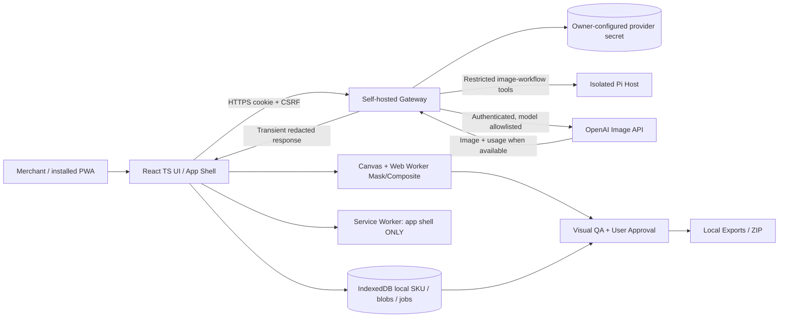

# System Architecture — Proposed Reference Design

## Architecture principles

Local-first for images and project state; no permanent server-side product-image store in P0. BYOK execution flows through trusted same-origin backend. Separation of source truth, AI output, validation and export is mandatory. Never rely on prompt-only fidelity. Security and cost boundaries matter more than framework elegance.

**Do not confuse arrows with deployed infrastructure.** This is the target architecture, not observed runtime.

The owner selected a browser-facing Pi Agent and a self-hosted gateway with server-configured provider key. [ADR-006](ADR.md) records the proposed restricted integration; host isolation and authentication remain subject to review. The diagram is a target, not implementation or deployment evidence.

## Ownership boundaries

| Component | Owns | Must NOT own |
|---|---|---|
| React UI | navigation, forms, flags, consent, safe state transitions | persistence of API Key, provider billing truth |
| Domain store | verified product facts, lock decisions, immutable job/QA records | invented product attributes, security secret |
| Image worker | mask, alpha composition, limited resize/export, worker memory cleanup | brand text re-generation in STRICT |
| Service Worker | versioned static app assets/update orchestration | API response caching, key or seller image caching |
| Self-hosted gateway | authentication, CSRF, allowlist, budgets and provider calls | public operator custody, broad arbitrary proxy or key disclosure |
| Server secret configuration | owner-controlled provider key provisioning, rotation and removal | browser, agent transcript, public source, logs or exports |
| Restricted Pi host | scoped image-workflow tool requests and session-bound events | provider key, shell, filesystem, arbitrary network or extensions |
| OpenAI adapter | vendor request/response mapping, throttling/error translation | Product verification/human approval |
| QA module | deterministic checks, visual advisory, hard-veto and review | certifying medical/regulatory product accuracy |
| Export module | approval filtering, manifest, portable ZIP | publishing to store or replacing original pixels |

## Data flow DFD-01 — Connect provider session

1. The owner configures the provider key on their self-hosted server, outside the browser. The storage mechanism and rotation procedure require security review.
2. The authenticated client posts the provider identifier to `/api/v2/session/connect` with CSRF protection; no provider key is accepted in the request.
3. The gateway binds a short-lived provider authorization to the authenticated app session and returns status only. Cookie and authentication designs require review.
4. Disconnect revokes the provider authorization. It does not delete the server configuration or revoke the key at OpenAI; those are separate owner actions.

## Data flow DFD-02 — Generate

1. Local client validates SKU, source angle, mode, mask, style, model and estimated cost.
2. User explicitly confirms the billable attempt. Persist a pending immutable Attempt locally, then request a server approval bound to its validated payload and the current sessions.
3. The gateway validates and atomically consumes that approval with attempt reservation before the allowlisted provider call; no arbitrary URLs, automatic paid retries or unapproved requests.
4. Provider bytes and usage pass through transiently with bounded memory and input/output limits. Client persists returned image Blob and metadata; treat remote output as untrusted until QA.
5. QA and explicit approval unlock approved export. Download writes locally. On timeout after submission, record UNKNOWN and avoid automatic resubmission.

## Failure isolation

- If offline, preserve editor and local data; no pretend queued online transaction.
- If server configuration or provider authorization is unavailable, disable AI generation but local operations continue.
- If provider policy/limits change, show provider error without reclassifying existing approved assets.
- If local storage quota exceeded, halt mutation safely; offer download/cleanup, never overwrite source assets.

## Nonfunctional targets (hypotheses)

- Local UI interactions remain responsive while processing a 12MP image in Web Worker; measure on mid-range mobile; reject/resize larger files through explicit UI.
- No Key leakage in local storage or client logs; redacted server telemetry.
- Browser restart restores product and job history, but sensitive session may need reconnect.
- Avoid false positive QA: human approval mandatory for product material facts.

## Future evolution

P1: automatic cutout, Brand Kit, batch/queue server persistence, verified listing-copy generator. P2: team cloud collaboration, distributed job queues, video and platform write APIs. The owner-requested Pi Agent is subject to ADR-006; avoid additional agents or databases without a validated need.
