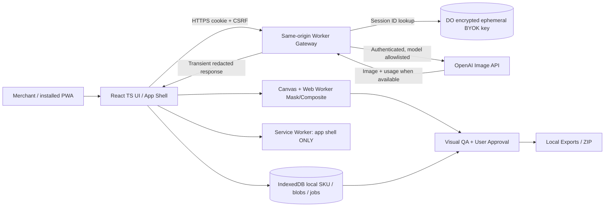

# System Architecture — Proposed Reference Design

## Architecture principles

Local-first for images and project state; no permanent server-side product-image store in P0. BYOK execution flows through trusted same-origin backend. Separation of source truth, AI output, validation and export is mandatory. Never rely on prompt-only fidelity. Security and cost boundaries matter more than framework elegance.

**Do not confuse arrows with deployed infrastructure.** This is the target architecture, not observed runtime.

The owner has since requested a browser-facing Pi Agent for the image workflow. [ADR-006](ADR.md) records that direction and the proposed restricted self-hosted integration boundary. The diagram above predates that request and does not yet represent a reviewed Pi host or approved API contract; no Pi service is implemented.

## Ownership boundaries

| Component | Owns | Must NOT own |
|---|---|---|
| React UI | navigation, forms, flags, consent, safe state transitions | persistence of API Key, provider billing truth |
| Domain store | verified product facts, lock decisions, immutable job/QA records | invented product attributes, security secret |
| Image worker | mask, alpha composition, limited resize/export, worker memory cleanup | brand text re-generation in STRICT |
| Service Worker | versioned static app assets/update orchestration | API response caching, key or seller image caching |
| BYOK Worker | authentication, CSRF, allowlist, budgets, ephemeral provider calls | indefinite plaintext Key storage, broad arbitrary proxy |
| Encrypted session vault | ciphertext Key / principal mapping / TTL / deletion | raw images or public-readable secret artifacts |
| OpenAI adapter | vendor request/response mapping, throttling/error translation | Product verification/human approval |
| QA module | deterministic checks, visual advisory, hard-veto and review | certifying medical/regulatory product accuracy |
| Export module | approval filtering, manifest, portable ZIP | publishing to store or replacing original pixels |

## Data flow DFD-01 — Connect BYOK

1. Authenticated user opens same-origin HTTPS app and deliberately enters Key; no analytics or form autofill copying the value.
2. `POST /api/session/connect` with CSRF token. Gateway verifies identity, validates input and encrypts Key with server-managed AEAD secret; stores ciphertext with TTL in scoped server store.
3. Server sets opaque session cookie (`Secure; HttpOnly; SameSite=Strict; Path=/api` where compatible) and returns status only; **never returns Key**. Cookie/session and account auth binding design require review.
4. App clears input and JS memory best-effort. Disconnect deletes server record and expires cookie. TLS and operator trust are still required; not a zero-knowledge design.

## Data flow DFD-02 — Generate

1. Local client validates SKU, source angle, mode, mask, style, model and estimated cost.
2. User explicitly confirms billable attempt. Persist pending immutable Attempt locally *before* send.
3. Gateway verifies identity + session + CSRF, validates model/size/format/bytes, maps one allowlisted provider API call (no arbitrary URL).
4. Provider bytes and usage pass through transiently. Avoid full base64 decoding in a 128MB Worker. Client persists returned image Blob and metadata; treat remote output as untrusted until QA.
5. QA and explicit approval unlock approved export. Download writes locally. On timeout after submission, record UNKNOWN and avoid automatic resubmission.

## Failure isolation

- If offline, preserve editor and local data; no pretend queued online transaction.
- If Vault/session unavailable, disable AI generation but local operations continue.
- If provider policy/limits change, show provider error without reclassifying existing approved assets.
- If local storage quota exceeded, halt mutation safely; offer download/cleanup, never overwrite source assets.

## Nonfunctional targets (hypotheses)

- Local UI interactions remain responsive while processing a 12MP image in Web Worker; measure on mid-range mobile; reject/resize larger files through explicit UI.
- No Key leakage in local storage or client logs; redacted server telemetry.
- Browser restart restores product and job history, but sensitive session may need reconnect.
- Avoid false positive QA: human approval mandatory for product material facts.

## Future evolution

P1: automatic cutout, Brand Kit, batch/queue server persistence, verified listing-copy generator. P2: team cloud collaboration, distributed job queues, video and platform write APIs. The owner-requested Pi Agent is subject to ADR-006; avoid additional agents or databases without a validated need.
