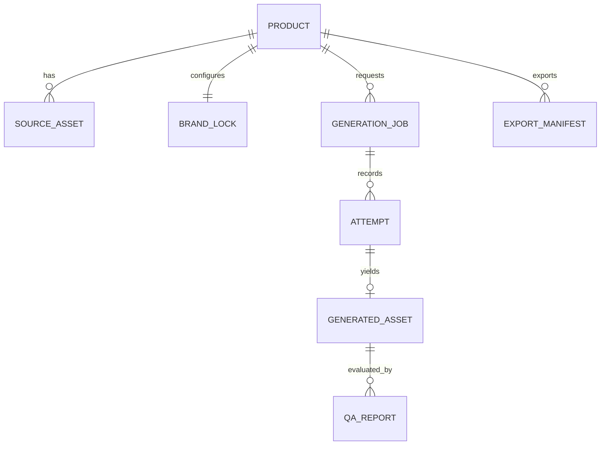

# Domain Model / Data Dictionary

**Machine-readable canonical contracts:** [`product.schema.json`](../../contracts/schemas/product.schema.json), [`generation-job.schema.json`](../../contracts/schemas/generation-job.schema.json), [`qa-report.schema.json`](../../contracts/schemas/qa-report.schema.json), [`export-manifest.schema.json`](../../contracts/schemas/export-manifest.schema.json). The table below explains intent; JSON schemas own fields.

## Entity relationship (proposed)

## Core semantics

- `Product`: unique `productId` (UUID), SKU, user-verified name/category, timestamps, rights acknowledgement and fact provenance. A variant is a separate SKU when label/color differs.
- `SourceAsset`: stable original photo hash and Blob path, width/height, EXIF-normalized viewing metadata, camera angle (`front`, `back`, `side`, `top`, `unknown`), visibility limits, artwork rights. The Blob must never be overwritten by derived previews.
- `VerifiedFact`: explicit text and `origin=user|visible_source`, sourceAssetId/ROI optional, confirmation time, confidence status; provider-inferred benefits do not become facts without user approval.
- `BrandLock`: STRICT/BALANCED/CREATIVE, protected text/regions/hex colors, forbidden edits, source view angle, mask asset hash, version, approval state.
- `StylePreset`: seven stable IDs and English add-on definitions, per-style defaults. See [`style-presets.json`](../../contracts/style-presets.json).
- `GenerationJob`: logical style output. Has chosen source/lock/prompt snapshot hash, model/quality/size/ratio and overall status. One job may have one or several billable `Attempts`.
- `Attempt`: unique UUID for each provider submission; immutable request hash, sending state, timestamps, provider ID, billing evidence and redacted error code. Never merge two attempts after retry.
- `GeneratedAsset`: image Blob hash, dimensions, format, parent attempt, source/type (`composite` vs `ai_edit` vs `concept`).
- `QAReport`: scoring details and hard-veto array; statuses `PASS_CANDIDATE`, `REVIEW_REQUIRED`, `REJECTED`, `UNVERIFIABLE`; human decision separate.
- `ExportManifest`: approved asset hashes and provenance; no secrets, no raw Key, no browser cookie; audit version.

## ID and time conventions

- UUID v4 IDs; namespaced `productId`, `jobId`, `attemptId`, `assetId` fields. Do not use array index as identity.
- UTC RFC3339 timestamps with `Z` for transport/storage. Display Asia/Singapore time in UI; never silently rewrite timestamps.
- Preserve immutable evidence. Derivatives have new content hash; references to deleted original produce invalid/incomplete project state, not silent reconstruction.
- Money in decimal string (`"0.1050"`) and ISO `USD` label; never IEEE floats as payment ledger. Provider usage can be missing; use `null` rather than zero.
- Product schema does **not** contain API credentials. Session information cannot be exported.

## Normalized local stores (suggested)

`products` keyed `productId`; `sourceAssets` keyed `assetId` with `blob`; `masks` keyed `maskId`; `jobs` keyed `jobId`; `attempts` keyed `attemptId`; `assets` keyed `assetId`; `qaReports` keyed `qaId`; `settings` non-secret only; `migrations` version journal. Implement atomic IndexedDB transactions for changes to interdependent metadata, with blob storage bounded by quota.

## Cross-document rules

Schema validation is necessary but does not prove facts true, user approved assets, or high fidelity. Schema extensions require a migration and bundle version. Prefer additive changes with backward-compatibility tests; reject incompatible import rather than silently discarding unknown fields.
