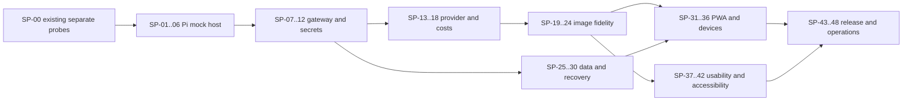

# Project Spike Test Catalog and Execution Plan

**Date:** 2026-10-29 (Asia/Singapore). **Status:** proposed research backlog, not application test evidence. Applies to the PWA AI Product Image Studio BYOK with a browser-facing Pi-based agent and OpenAI image generation. The [task ledger](../08-delivery/TASK.md), [decision register](../00-governance/DECISION_REGISTER.md), [security/performance plan](../07-quality/SECURITY_PERFORMANCE.md), and [release gates](../07-quality/RELEASE_GATES.md) remain authoritative. Spike IDs are research references, not additional product requirements or claims of readiness.

## Current facts and decision rules

- There is no implemented project PWA, image gateway or Pi-to-image integration. Pi 1.4.0 completed one restricted OpenAI text call; one **separate** direct OpenAI image call produced a synthetic mug image. Exact usage and cost were not captured. See [existing spike evidence](PI_OPENAI_SPIKE.md). Do not infer end-to-end success.
- Owner direction is self-hosted BYOK gateway, browser-facing Pi agent, seven styles and STRICT source-based fidelity. Runtime, public identity, custody implementation, retention, actual model availability and other OPEN decisions are unresolved.
- Priority `P0` = decide before building or releasing the relevant critical path; `P1` = decide before a broader pilot or release when applicable; `P2` = useful for later scale or expansion. These are proposed research priorities, not approved schedules.
- Modes: `M` = mock/local, no provider charge; `L` = live provider request, possible charges; `D` = real device/browser required; `H` = human participants and consent; `E` = isolated environment / synthetic destructive test. Combinations such as `M+D` need both. `L` always needs a fresh, explicit spending envelope for the specific batch, allowed key scope, maximum requests/models/size and stopping rule before execution. This catalog does not authorize spending, deployments, seller outreach or use of real brand assets.
- `SP-00` contains two recorded live-probe passes. `SP-01` and `SP-02` have bounded synthetic SDK observations in the task ledger; their full acceptance and all remaining spikes remain **NOT RUN** unless separately evidenced. Later results require execution date, revision, environment, concrete observations, failures, costs where available, evidence links and decision.

## Order and dependency map

This is an indicative path, not a mandate to serially block independent local mock research. Live calls and external participants are separate gates. A small throwaway prototype may answer a spike but must not be mistaken for production security or completed delivery work.

## Completed baseline

| ID | Priority / mode | Question and method | Evidence / boundary |
|---|---|---|---|
| SP-00 | P0 / L | Can local Pi make a restricted OpenAI text request and can the owner key separately generate an image? | **PASS for two independent probes**, not agent-to-image, browser, gateway or fidelity. [Evidence](PI_OPENAI_SPIKE.md). |

## A. Pi runtime, agent and tool isolation

| ID | Priority / mode | Question and minimum experiment | Acceptance / evidence; prerequisites |
|---|---|---|---|
| SP-01 | P0 / M | Can Pi SDK start with an in-memory session and exactly one fake `generate_image` tool? Feed synthetic prompt; inspect tool and session events. | **PARTIAL:** Pi 1.4.0 in-memory session exposed only the fake tool and emitted one start/end pair for an in-process mock-model tool call. No filesystem sandbox or actual host boundary was tested. [Observation](../08-delivery/TASK.md#pi-mock-preflight-observation--2026-10-29). |
| SP-02 | P0 / M | Does structured image-tool invocation reject malformed, extra or unapproved arguments? Test missing fields, unknown models, enormous prompts and URL fields. | **PARTIAL:** a sample strict schema rejected four synthetic invalid inputs before the fake tool and accepted one valid request. This is not the product tool or provider adapter. [Observation](../08-delivery/TASK.md#pi-mock-preflight-observation--2026-10-29). |
| SP-03 | P0 / M+E | Can prompt injection or tool output convince Pi to read `.env`, execute shell, call arbitrary hosts or reveal a test canary? Inject text in source metadata and tool results. | No exposed tool or response contains the canary; denied operations create zero calls. This is bounded testing, not a proof against all injection. SP-01. |
| SP-04 | P0 / M+E | Can sessions A and B access each other's prompts, images, tokens or result events? Interleave two synthetic principals. | No cross-session reads/writes or credential reuse; verify separate event traces and cleanup. Requires actual host auth/session boundary, not just separate agent objects. |
| SP-05 | P1 / M | What happens on cancel, process crash, restart and concurrent agent runs? Inject each event before and during mock tool execution. | Show terminal/unknown states honestly, release resources and avoid duplicate paid intent; document evidence. SP-01 and state prototype. |
| SP-06 | P1 / M | Do agent transcripts, error messages and logs expose a fake key or untrusted prompt contents? Inject synthetic canary and inspect all outputs. | No canary or raw sensitive data in persistence, logs or UI; redaction verified without real secrets. SP-01. |

## B. BYOK gateway, access and security

| ID | Priority / mode | Question and minimum experiment | Acceptance / evidence; prerequisites |
|---|---|---|---|
| SP-07 | P0 / M | Compare a self-hosted Node/Bun Pi host with a separate gateway/host process. Trace key, image, request and event boundaries. | ADR records feasible deployment, identity, failure modes and rejected alternatives; no claim that either is approved. Requires OPEN-001/003 context. |
| SP-08 | P0 / M+E | Does a fake key stay out of browser persistence, URLs, service worker caches, logs and bundles during connect/disconnect? | Synthetic canary absent in localStorage, sessionStorage, IndexedDB, CacheStorage, ZIP and collected server logs. SP-07 plus local prototype; SEC-004. |
| SP-09 | P0 / M+E | Can unauthenticated, cross-origin, CSRF, session fixation or cross-user requests reach the fake provider? | All unauthorized requests denied and zero downstream calls; authenticated correct-owner path works. SP-07; SEC-002/003. |
| SP-10 | P0 / M+E | Are provider endpoints, models, URLs, redirects and request size constrained? Attempt attacker URL, redirect and disallowed model. | Reject before forwarding credentials or provider calls; fixed allowlist tested with fake secret. SP-07; SEC-005. |
| SP-11 | P0 / M+E | Do expiry, disconnect, process restart and server-key rotation/removal enforce the selected secret lifecycle? Use fake tokens and simulated time. | Expired/revoked sessions cannot call provider; recovery and separate provider revocation documented; don't assume background timer fires exactly on time. OPEN-003/004. |
| SP-12 | P1 / M+E | Can archive uploads or source images exploit parser, path traversal, oversized dimensions, MIME mismatch or decompression expansion? | Bounded processing; unsafe entries rejected without partial mutations; source and unrelated projects remain intact. SEC-006; use only synthetic malicious fixtures. |

## C. OpenAI adapter, billing and reliability

| ID | Priority / mode | Question and minimum experiment | Acceptance / evidence; prerequisites |
|---|---|---|---|
| SP-13 | P0 / M | Does the adapter correctly translate allowlisted input and provider response, including missing usage? Use recorded synthetic contracts. | Correct error mapping; no key in output; absent usage remains UNKNOWN, not zero; every call tied to one immutable attempt. |
| SP-14 | P0 / M+E | How do timeout before/after send, connection reset, 429, 5xx and cancellation affect job state? Use controlled fake server. | Post-send ambiguity yields UNKNOWN; no automatic paid retry; confirmed manual retry creates a distinct attempt. SP-13; E2E-015. |
| SP-15 | P0 / M+E | Do replay, concurrent submit and mismatched request IDs prevent duplicates without claiming provider idempotency? | Defined local reservation scope and atomic behavior documented; exact replay causes no second mock send, changed payload conflicts; unknown provider outcome remains UNKNOWN. OPEN-008. |
| SP-16 | P0 / M | Can estimates and hard/soft limits be shown before each action? Vary style count, model, known/unknown usage and failed attempts. | Count every explicit attempt, show estimates as estimates, block over configured cap and disclose unavailable usage. Authoritative invoicing stays at provider. SP-13/14. |
| SP-17 | P1 / L | Which selected image models, sizes, edits and response fields work on the owner's account? Freeze a small approved case matrix and call budget. | Record sanitized status, settings, output metadata and observed usage; capture failure categories and unknowns; no unapproved real product images. Existing direct `gpt-image-2` generation is one data point, not model-wide support. |
| SP-18 | P1 / L | How do one style, repeated attempts and optional model settings differ in cost, latency and usability? Hold prompt/fixtures/settings constant. | Report request count, distribution and actual provider-reported usage where available, invoice reconciliation and omitted values; small samples are exploratory. SP-16/17 plus per-run cap. |

## D. Source truth, mask and image fidelity

| ID | Priority / mode | Question and minimum experiment | Acceptance / evidence; prerequisites |
|---|---|---|---|
| SP-19 | P0 / M | Can source pixels and metadata be preserved across intake, EXIF orientation and save? Use synthetic JPEG/PNG/WebP fixtures and hashes. | Immutable original bytes/hash retained; orientation recorded and output transforms traceable; corrupt/unsupported inputs fail safely. T-021. |
| SP-20 | P0 / M+D | Can manual masking handle white-on-white, fine edges, glass and reflective surfaces? Inspect with contrasting backgrounds. | Source and mask preserved, edge defects visible, usable correction/undo; label visibility and source limitations documented. OPEN-005. |
| SP-21 | P0 / M | Can STRICT compose a source-derived foreground over a synthetic scene without generative redraw of the protected product? Compare source/cutout ROI and rendered results. | Source pixels used where intended, label/shape changes vetoed, transforms/resampling/compression documented; no universal pixel-perfect claim. SP-19/20. |
| SP-22 | P0 / M | What if a true overhead/side view or tiny readable text is not present in source? Test insufficient reference fixtures. | STRICT blocks unsupported angle or offers same-angle alternative; labels marked UNVERIFIABLE when source cannot prove them; no invented facts. SP-19. |
| SP-23 | P1 / L+H | Does a blinded product review distinguish STRICT composites from reference-based edits across 5 rights-cleared categories? Use the existing pilot protocol. | Record source/label/geometry vetoes, reviewer disagreement, exclusions and per-SKU correlation; no unsupported accuracy rate from tiny sample. Requires rights, budget and reviewer consent. |
| SP-24 | P1 / M+D | What export formats, resampling, ICC/color handling, transparent edges and compression change the visible result? | Compare documented crops, dimensions and visual quality to the original on target device; label any transformations, no silent source overwrite. SP-21. |

## E. Local data, queue, backups and recovery

| ID | Priority / mode | Question and minimum experiment | Acceptance / evidence; prerequisites |
|---|---|---|---|
| SP-25 | P0 / M | Can local data represent one SKU, seven styles and immutable per-attempt lineage? Exercise cancel, retry and partial completion. | Each attempt has own state, source hash, model, cost/usage status and QA; no cross-style overwrite. T-020/041. |
| SP-26 | P0 / M+E | What happens when storage quota is exhausted mid-save? Force failure at each transaction boundary. | No partial source replacement; UI provides recovery; previous committed draft remains readable. T-020; E2E-016. |
| SP-27 | P0 / M+E | Can backup and restore validate hashes, paths, schema version and migration without destroying existing projects? | Preview and reject corrupt/traversal/bomb fixtures; rollback on failed import; only synthetic data. T-022. |
| SP-28 | P1 / M+D | Do data and projects survive restart, denied persistence and private browsing as described? | Record actual browser/device and observed eviction/recovery; never promise permanent backup. T-020 and representative devices. |
| SP-29 | P1 / M | Can a seven-style queue handle 1/3/7 selections, partial errors, cancellation and bounded concurrency? | Exactly one attempt per requested send, distinct statuses and outputs; mock call counts reconcile with UI. T-041/070. |
| SP-30 | P1 / M+E | Can app and schema migrate older drafts and undo a failed upgrade? | Reproducible backup/restore, version checks and rollback without silent data loss; define forward/back compatibility. T-020/022. |

## F. PWA, browser and device behavior

| ID | Priority / mode | Question and minimum experiment | Acceptance / evidence; prerequisites |
|---|---|---|---|
| SP-31 | P0 / M+D | What works offline after first successful install vs first launch offline? Inspect shell, local images and blocked generation. | Report each state truthfully; no API, keys or seller images cached in generic SW cache; no phantom success. T-011; E2E-018. |
| SP-32 | P0 / M+D | Does N→N+1 service-worker update preserve an unsaved mask and activate only after user choice? Use two real builds. | Prompt, save/flush, visible loader, controller transition and failure recovery; no unexpected reload. T-011; PERF-005. |
| SP-33 | P0 / M+D | Do iOS Safari and installed PWA respect safe areas, opaque theme chrome, keyboard and navigation? | Capture real-device versions/screens; no important control obscured, lost draft or inaccessible close. T-010/080; simulator is insufficient for release. |
| SP-34 | P1 / M+D | Does Android Chromium installed mode handle offline, back, keyboard and file picker? | Actual-device record for install and above states; no overflow or lost project. T-080. |
| SP-35 | P1 / M+D | How do 12 MP and larger images affect decode, mask, memory, CPU, orientation and object URL cleanup? | Record p50/p95 or raw small-sample values, device model, sizes, failure counts and crash/OOM; do not claim a target passed without a prior target. PERF-001..004. |
| SP-36 | P1 / M+D | If a local companion is considered, can desktop loopback and phone-to-desktop LAN connect safely? | Record permission/CORS/secure-context support per browser; fake token pairing and hostile-origin denial; phone localhost is not desktop localhost. Alternative only, not approved architecture. |

## G. UI/UX, accessibility and product fit

| ID | Priority / mode | Question and minimum experiment | Acceptance / evidence; prerequisites |
|---|---|---|---|
| SP-37 | P0 / M+D | Does the image-first layout work at 320/375/390/768/1024/1280 CSS px, landscape, long names and 200% real zoom? | No clipped essential controls or unintended page overflow; record screenshots, viewport rectangles and browser versions. Approved anchor selection remains pending. |
| SP-38 | P0 / M+D | Can keyboard and single-pointer users compare, zoom, move/crop and correct masks without drag-only controls? | Each essential action has an equivalent accessible path; focus/order/labels verified; test actual workflow, not only static controls. |
| SP-39 | P0 / M+D | Can a screen reader and reduced-motion user navigate dialogs, live job status and QA? | Semantic names, focus containment/return and non-color states verified; nonvisual QA limitations disclosed; manual review with assistive tech. |
| SP-40 | P1 / H | Can 5–8 consenting target sellers create a single reviewed export without coaching? | Log task completion, time, errors and qualitative issues; consent and synthetic/authorized assets; small convenience sample is not market prevalence. |
| SP-41 | P1 / H | Do users understand STRICT vs concept, cost estimate, separate attempts and UNKNOWN? Test common error scenarios. | Capture observed misunderstandings and user wording; do not define a target rate retroactively. Requires approved prototype and consent. |
| SP-42 | P1 / M+H | Are chosen Shopee/Lazada/Shopify presets and listing rules correct for country/category and user needs? | Record current authoritative country/category source/date; user-test preset discoverability; no inferred platform-compliance badges. OPEN-007. |

## H. Operations, release and scalability

| ID | Priority / mode | Question and minimum experiment | Acceptance / evidence; prerequisites |
|---|---|---|---|
| SP-43 | P0 / M+E | Can the documentation validator distinguish Git metadata, ignored artifacts and unexpected payload files? | T-002 regression includes real checkout plus clean package, altered hashes and extra payload; no weakened checks. |
| SP-44 | P1 / M | Can a clean install run locally with an empty `.env` and clear diagnostic, without leaking or committing keys? | Document reproducible setup, fake-key-only checks, dependency versions and rollback; no logs with secrets. T-010/030. |
| SP-45 | P1 / M+E | Can developer simulate provider outage, vault failure, expired key, 429 and crash during submit? | Operator sees actionable redacted state, no unsafe retry, source intact; incident runbook and recovery evidence. |
| SP-46 | P1 / M+E | Can version rollback preserve current IndexedDB schema, queued attempts and original images? | Exercise backup, incompatible rollback and recovery on synthetic projects; no silent deletion or automatic reload. SP-30/32. |
| SP-47 | P2 / M+E | What are memory/concurrency and request body constraints for the chosen self-hosted runtime or alternative? | Measure peak memory, CPU, payload/copies and rejection at chosen caps; no inference from one provider's limit to another. |
| SP-48 | P2 / M+E | How does the system handle repeated rapid submissions across sessions under a simulated cap? | Counters, limits and stop conditions enforced at authoritative boundary; no surprise paid requests. T-042/081; use mocks. |

## Suggested first five experiments

1. **SP-01** — SDK-only fake tool and in-memory session; establish that only the intended tool is available.
2. **SP-02 + SP-03** — reject invalid tool arguments and synthetic injection before any external calls.
3. **SP-07** — compare the Pi host/gateway boundaries and record the decision and remaining security questions.
4. **SP-13 + SP-14** — fake OpenAI adapter, force missing usage, timeout and UNKNOWN behavior.
5. **SP-19 + SP-21** — source integrity and synthetic STRICT compositor proof; this validates mechanics, not brand quality.

Each can start with dummy inputs; do not wait for a live image request to discover basic security and state bugs. Sequence may change after T-001 preflight and architecture review.

## Repeatable run record and exit criteria

For each spike record: `ID`, owner, date/timezone, Git revision and dirty state, hypothesis, assumptions, exact scope and setup, synthetic fixture provenance, device/browser/provider version, tool/model and configuration, environment isolation, authorized spend/request cap, commands or sanitized steps, observable result and raw evidence location, actual call count/cost if known, security/privacy observations, pass/fail/unknown, decision and follow-up task/ADR, cleanup and rollback. Never put keys, personal data, private product images or raw sensitive prompts into the record.

A spike **PASS** answers only its stated hypothesis and configuration. `NOT RUN`, `FAIL`, `INCONCLUSIVE`, `UNKNOWN` and `BLOCKED` must be distinct; do not treat skipped checks as passing. Owner or reviewer decisions are recorded separately from technical findings. Stop on unexpected external calls, key exposure, unsafe auto-retry, budget exhaustion or corrupted state; isolate affected work, preserve evidence and do not retry an ambiguous paid request automatically. A release requires the existing release gates, not only a passing spike catalog.

## Primary references and evidence scope

- [Pi security](https://github.com/earendil-works/pi/blob/main/packages/coding-agent/docs/security.md): local agent tools and process permissions; project trust is not a sandbox.
- [OpenAI image generation](https://developers.openai.com/api/docs/guides/image-generation): provider interfaces and model-specific behavior; recheck at execution.
- [OWASP file upload guidance](https://cheatsheetseries.owasp.org/cheatsheets/File_Upload_Cheat_Sheet.html): defense-in-depth for upload and archive handling.
- [MDN storage quotas and eviction](https://developer.mozilla.org/en-US/docs/Web/API/Storage_API/Storage_quotas_and_eviction_criteria): browser storage durability varies.
- [W3C dragging movements](https://www.w3.org/WAI/WCAG22/Understanding/dragging-movements.html): single-pointer alternatives subject to criterion exceptions.
- [Cloudflare Workers limits](https://developers.cloudflare.com/workers/platform/limits/): relevant only if that alternative is selected; not proof of self-hosted limits.
