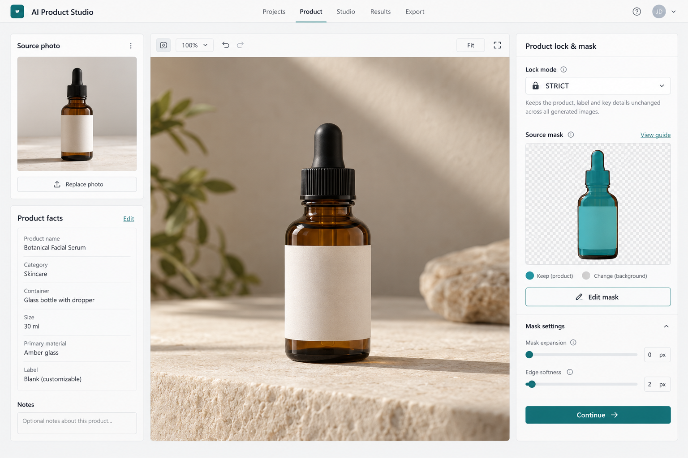
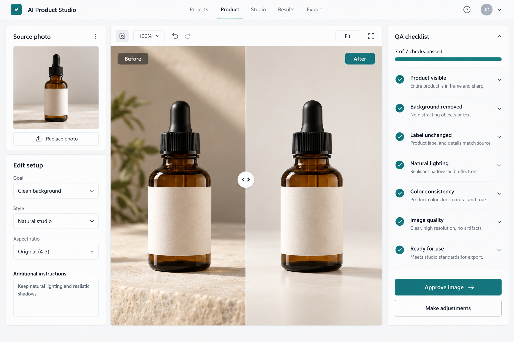
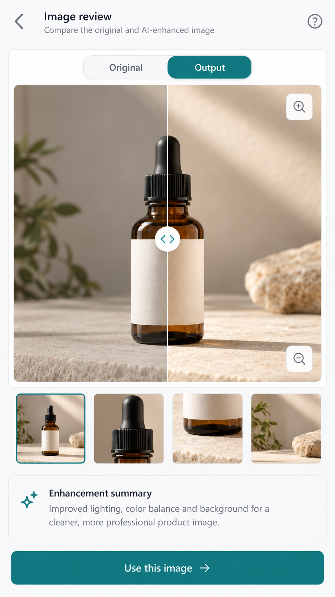

# Visual Anchor Catalog — 50 Proposed UI Concepts

**Status:** PROPOSED; individual owner review and visual accessibility verification remain pending. These are static generative images, not implemented application screens. See [Design System](DESIGN_SYSTEM.md) for authority, known inaccuracies and promotion criteria.

## Preview

### Desktop product workspace

### Tablet comparison

### Mobile comparison

## Image catalog

| ID | Concept and prompt subject | Device | Status |
|---|---|---|---|
| 01 | [Product Workspace](visual-anchors/01-desktop-product-workspace.png) | Desktop | PROPOSED |
| 02 | [Projects](visual-anchors/02-desktop-projects.png) | Desktop | PROPOSED |
| 03 | [Empty](visual-anchors/03-desktop-empty.png) | Desktop | PROPOSED |
| 04 | [Upload](visual-anchors/04-desktop-upload.png) | Desktop | PROPOSED |
| 05 | [Source Details](visual-anchors/05-desktop-source-details.png) | Desktop | PROPOSED |
| 06 | [Mask Editor](visual-anchors/06-desktop-mask-editor.png) | Desktop | PROPOSED |
| 07 | [Studio Styles](visual-anchors/07-desktop-studio-styles.png) | Desktop | PROPOSED |
| 08 | [Style Studio](visual-anchors/08-desktop-style-studio.png) | Desktop | PROPOSED |
| 09 | [Style Hero](visual-anchors/09-desktop-style-hero.png) | Desktop | PROPOSED |
| 10 | [Style Lifestyle](visual-anchors/10-desktop-style-lifestyle.png) | Desktop | PROPOSED |
| 11 | [Style Flat Lay](visual-anchors/11-desktop-style-flat-lay.png) | Desktop | PROPOSED |
| 12 | [Style Macro](visual-anchors/12-desktop-style-macro.png) | Desktop | PROPOSED |
| 13 | [Style UGC](visual-anchors/13-desktop-style-ugc.png) | Desktop | PROPOSED |
| 14 | [Style Billboard](visual-anchors/14-desktop-style-billboard.png) | Desktop | PROPOSED |
| 15 | [Cost Confirmation](visual-anchors/15-desktop-cost-confirmation.png) | Desktop | PROPOSED |
| 16 | [Queue Running](visual-anchors/16-desktop-queue-running.png) | Desktop | PROPOSED |
| 17 | [Queue Partial](visual-anchors/17-desktop-queue-partial.png) | Desktop | PROPOSED |
| 18 | [Unknown Attempt](visual-anchors/18-desktop-unknown-attempt.png) | Desktop | PROPOSED |
| 19 | [Compare](visual-anchors/19-desktop-compare.png) | Desktop | PROPOSED |
| 20 | [QA Fail](visual-anchors/20-desktop-qa-fail.png) | Desktop | PROPOSED |
| 21 | [Export](visual-anchors/21-desktop-export.png) | Desktop | PROPOSED |
| 22 | [Settings](visual-anchors/22-desktop-settings.png) | Desktop | PROPOSED |
| 23 | [Offline](visual-anchors/23-desktop-offline.png) | Desktop | PROPOSED |
| 24 | [Update](visual-anchors/24-desktop-update.png) | Desktop | PROPOSED |
| 25 | [Dark](visual-anchors/25-desktop-dark.png) | Desktop | PROPOSED |
| 26 | [Components](visual-anchors/26-desktop-components.png) | Desktop | PROPOSED |
| 27 | [Projects](visual-anchors/27-tablet-projects.png) | Tablet | PROPOSED |
| 28 | [Product](visual-anchors/28-tablet-product.png) | Tablet | PROPOSED |
| 29 | [Studio](visual-anchors/29-tablet-studio.png) | Tablet | PROPOSED |
| 30 | [Compare](visual-anchors/30-tablet-compare.png) | Tablet | PROPOSED |
| 31 | [Mask](visual-anchors/31-tablet-mask.png) | Tablet | PROPOSED |
| 32 | [Queue](visual-anchors/32-tablet-queue.png) | Tablet | PROPOSED |
| 33 | [Projects](visual-anchors/33-mobile-projects.png) | Mobile | PROPOSED |
| 34 | [Empty](visual-anchors/34-mobile-empty.png) | Mobile | PROPOSED |
| 35 | [Upload](visual-anchors/35-mobile-upload.png) | Mobile | PROPOSED |
| 36 | [Product](visual-anchors/36-mobile-product.png) | Mobile | PROPOSED |
| 37 | [Mask](visual-anchors/37-mobile-mask.png) | Mobile | PROPOSED |
| 38 | [Styles](visual-anchors/38-mobile-styles.png) | Mobile | PROPOSED |
| 39 | [Style Settings](visual-anchors/39-mobile-style-settings.png) | Mobile | PROPOSED |
| 40 | [Cost Confirm](visual-anchors/40-mobile-cost-confirm.png) | Mobile | PROPOSED |
| 41 | [Queue](visual-anchors/41-mobile-queue.png) | Mobile | PROPOSED |
| 42 | [Unknown — corrected v2](visual-anchors/42-mobile-unknown-v2.png) | Mobile | PROPOSED |
| 43 | [Compare](visual-anchors/43-mobile-compare.png) | Mobile | PROPOSED |
| 44 | [QA](visual-anchors/44-mobile-qa.png) | Mobile | PROPOSED |
| 45 | [Export](visual-anchors/45-mobile-export.png) | Mobile | PROPOSED |
| 46 | [Settings](visual-anchors/46-mobile-settings.png) | Mobile | PROPOSED |
| 47 | [Offline](visual-anchors/47-mobile-offline.png) | Mobile | PROPOSED |
| 48 | [Update](visual-anchors/48-mobile-update.png) | Mobile | PROPOSED |
| 49 | [Dark](visual-anchors/49-mobile-dark.png) | Mobile | PROPOSED |
| 50 | [Keyboard](visual-anchors/50-mobile-keyboard.png) | Mobile | PROPOSED |

## Prompt set and provenance

Built-in ImageGen was used for every image. Screen 01 was generated as a desktop product workspace with a fictional unbranded amber skincare bottle, source/facts panel, large canvas, STRICT mask inspector, neutral surfaces and teal accent. Screens 02–04 used that first image as a style reference and asked respectively for projects home, first-use empty projects, and source upload/rights confirmation. For screens 05–50 the shared prompt below was combined with the corresponding catalog subject and device, using screen 01 as the visual reference:

> Use case: ui-mockup. Create one standalone polished realistic interface for the indicated screen and device. Use the reference image as a style reference only: restrained neutral surfaces, slate readable text, subtle borders, rich teal primary accent, image-first functional hierarchy, and a fictional unbranded amber skincare bottle when useful. Make the requested state prominent; adapt the layout to the device. This is a concept, not proof of a working interface. Do not include real keys, platform compliance badges, claims of guaranteed fidelity, invented actual costs, marketing mockups or surrounding captions.

Screen 42 v2 was generated by editing the first version to state that the request may have been processed and charged, that it will not retry automatically, and that the user can review a retry or return to results. The [first version](visual-anchors/42-mobile-unknown.png) is retained as SUPERSEDED because it incorrectly asserted that no credits were used. The catalog contains 50 current concepts and one retained historical image.

The prompt topics are the descriptions in the table. Generated content can nevertheless introduce unsupported features or inaccurate text; the project specifications and [known defects](DESIGN_SYSTEM.md) govern review. No score, user test or owner approval is claimed.
